# Temat projektu

**Wędkarski Radar** to aplikacja internetowa, którą stworzyłem dla społeczności pasjonatów wędkarstwa. Głównym celem mojej aplikacji jest agregowanie i udostępnianie informacji o akwenach wodnych w całej Polsce, ich rybostanie oraz aktualnych warunkach pogodowych wpływających na aktywność ryb. 

Zaprojektowałem tę aplikację jako centrum planowania wypraw wędkarskich, które ułatwia odkrywanie nowych łowisk, analizowanie warunków brania w czasie rzeczywistym oraz budowanie społecznościowej tablicy rekordowych okazów.

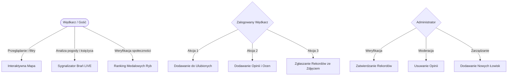

### Lista pytań pomocniczych

#### 1. Jaki problem rozwiązuje moja aplikacja?
Wędkarze przygotowujący się do wyprawy często muszą szukać informacji w wielu różnych miejscach. Zazwyczaj muszą osobno sprawdzać:
*   Dane o zarybieniu i typie akwenu na starych forach internetowych lub grupach społecznościowych.
*   Prognozę pogody w aplikacjach meteorologicznych.
*   Aktualne ciśnienie atmosferyczne (którego gwałtowne wahania blokują żerowanie ryb).
*   Fazy księżyca (wpływające na żerowanie ryb, zwłaszcza drapieżnych w nocy).
*   Lokalizację, infrastrukturę i dojazd na mapach.

**Rozwiązałem ten problem kompleksowo.** W swoim projekcie zintegrowałem mapę geograficzną, strukturę zarybienia, algorytm wyliczania dobowej aktywności ryb w czasie rzeczywistym oraz opinie innych wędkarzy w jednym, spójnym i responsywnym interfejsie.

#### 2. Jeśli istnieją podobne rozwiązania, to czym moja aplikacja się wyróżnia?
*   **Dynamiczny Sygnalizator Brań (Bite Forecast LIVE):** Zaimplementowałem algorytm, który w oparciu o bieżące dane z API pogodowego (temperatura, ciśnienie, trend ciśnienia, opady, wiatr), fazę księżyca oraz porę dnia, wyznacza wskaźnik brania ryb w skali od 0 do 100 pkt.
*   **Wykres Dobowy:** Zastosowałem wykres w postaci fali (krzywej Beziera SVG) pokazujący godziny szczytów żerowania na dany dzień, oczyszczony z niepotrzebnych, zakłócających czytelność punktów i ostrych załamań.
*   **Geolokalizacyjny filtr odległościowy (promień sferyczny):** Wdrożyłem możliwość wyszukania łowisk w promieniu od 0 do 500 km od wybranej miejscowości.
*   **Wielopoziomowy system weryfikacji rekordów:** Stworzyłem system zgłaszania okazów ze zdjęciem przesyłanym z dysku, które przed publikacją w rankingu medalowym danego łowiska muszą przejść weryfikację administratora.

---

## Uruchomienie projektu (developer)

### Użyte technologie

| Technologia | Rola w projekcie | Dokładna wersja | Oficjalna strona |
| :--- | :--- | :--- | :--- |
| **PHP** | Język programowania backendu | `^8.3` (kompatybilny z `8.4` i `8.5`) | [php.net](https://www.php.net/) |
| **Laravel** | Framework aplikacji webowej | `13.0.0` (13.x) | [laravel.com](https://laravel.com/) |
| **Livewire** | Dynamiczne komponenty interfejsu (Full-stack) | `^4.1` | [livewire.laravel.com](https://livewire.laravel.com/) |
| **Laravel Fortify** | Silnik uwierzytelniania i autoryzacji | `^1.34` | [laravel.com](https://laravel.com/docs/11.x/fortify) |
| **SQLite 3** | Baza danych (lokalna/deweloperska) | `3.x` | [sqlite.org](https://www.sqlite.org/) |
| **TailwindCSS** | Framework stylizacji UI i komponentów | `^4.0.7` | [tailwindcss.com](https://tailwindcss.com/) |
| **Vite** | Szybki system kompilacji assetów i bundling | `^8.0.0` | [vite.dev](https://vite.dev/) |
| **HTML5 Geolocation** | Odczyt aktualnej lokalizacji GPS urządzenia | Wbudowany | [w3.org](https://www.w3.org/TR/geolocation/) |
| **Leaflet JS** | Biblioteka do renderowania mapy i znaczników | `1.9.4` | [leafletjs.com](https://leafletjs.com/) |
| **Nominatim API** | Silnik geokodowania (konwersja miast na GPS) | Bezkluczowy | [nominatim.org](https://nominatim.org/) |
| **Open-Meteo API** | Bezpłatne API prognozy meteorologicznej (LIVE) | Bezkluczowe | [open-meteo.com](https://open-meteo.com/) |
| **MediaWiki API** | API do pobierania zdjęć z Wikipedii | Bezkluczowe | [mediawiki.org](https://www.mediawiki.org/) |

### Wymagania programowe

Narzędzia niezbędne do zbudowania i uruchomienia projektu w trybie deweloperskim na czystym komputerze:

- **System operacyjny:** Windows 10/11, macOS lub Linux (Ubuntu/Debian).
- **Środowisko uruchomieniowe / SDK:** PHP w wersji minimum `8.3` wraz z rozszerzeniami: `pdo_sqlite`, `mbstring`, `xml`, `curl`, `openssl`, a także Node.js `v20.x` lub nowszy.
- **Silnik bazy danych:** SQLite 3 (zintegrowany z PHP).
- **Dodatkowe narzędzia:** Composer (menedżer pakietów PHP), npm (menedżer pakietów JavaScript).

### Szybka instalacja (jednym kliknięciem)

Przygotowałem skrypt automatyzujący cały proces instalacji i konfiguracji projektu na systemie Windows. Skrypt `INSTALACJA.bat` znajduje się w katalogu głównym projektu i wykonuje kolejno wszystkie kroki opisane poniżej (sprawdzanie wymagań, instalacja zależności, konfiguracja bazy, seedowanie).

**Użycie:**
1. Rozpakuj paczkę ZIP z projektem na dysku.
2. Otwórz folder `lowiska` i kliknij dwukrotnie na plik **`INSTALACJA.bat`**.
3. Skrypt automatycznie:
   - Sprawdzi, czy zainstalowane są PHP, Composer, Node.js i npm (w razie braku wyświetli komunikat z linkiem do pobrania).
   - Zainstaluje wszystkie zależności backendowe (`composer install`) i frontendowe (`npm install`).
   - Utworzy plik `.env` na podstawie szablonu `.env.example`.
   - Wygeneruje klucz bezpieczeństwa aplikacji.
   - Uruchomi migracje bazy danych SQLite i zasili ją danymi testowymi.
   - Utworzy link symboliczny do katalogu przechowywania plików.
4. Po zakończeniu instalacji, uruchom projekt w dwóch terminalach (jak opisano w sekcji „Uruchomienie projektu w terminalu").

> Alternatywnie, poniżej opisany jest ręczny proces instalacji krok po kroku.

### Proces instalacji (ręcznie)

1. **Rozpakowanie projektu:**
   Rozpakuj paczkę ZIP z projektem na swoim dysku, a następnie otwórz terminal (np. PowerShell lub Wiersz poleceń) i przejdź do katalogu głównego projektu (folderu `lowiska` zawierającego plik `composer.json`):
   ```bash
   cd sciezka/do/rozpakowanego/folderu/lowiska
   ```
2. **Instalacja zależności backendowych (PHP):**
   Uruchom instalator Composer w katalogu głównym projektu w celu pobrania niezbędnych bibliotek PHP:
   ```bash
   composer install
   ```
3. **Instalacja zależności frontendowych (Node.js):**
   Pobierz biblioteki JavaScript i silnik TailwindCSS za pomocą npm:
   ```bash
   npm install
   ```

### Proces konfiguracji

1. **Zmienne środowiskowe:**
   Utwórz plik `.env` na podstawie pliku szablonu `.env.example`:
   ```bash
   cp .env.example .env
   ```
   Wygeneruj unikalny klucz bezpieczeństwa aplikacji Laravel:
   ```bash
   php artisan key:generate
   ```
2. **Baza danych:**
   Upewnij się, że w pliku `.env` ustawione jest połączenie SQLite:
   ```env
   DB_CONNECTION=sqlite
   ```
3. **Migracje i dane początkowe (Seed):**
   Uruchom migracje, aby utworzyć strukturę tabel, oraz zasil bazę domyślnymi danymi testowymi:
   ```bash
   php artisan migrate --seed
   ```
   *Opcjonalnie:* Aby pobrać rzeczywiste zdjęcia z Wikipedii dla wszystkich łowisk i gatunków ryb (poprzez integrację z MediaWiki API), przygotowałem dedykowany seeder:
   ```bash
   php artisan db:seed --class=UpdateUniqueImagesSeeder
   ```
4. **Link symboliczny do załączników:**
   Utwórz powiązanie katalogu przechowywania plików, aby wgrane przez użytkowników zdjęcia rekordów były publicznie widoczne w przeglądarce:
   ```bash
   php artisan storage:link
   ```

#### Domyślne dane logowania:
*   **Konto Administratora:**
    *   **E-mail / Login:** `admin@lowisko.pl`
    *   **Hasło:** `password`
*   **Konto Przykładowego Wędkarza:**
    *   **E-mail / Login:** `jan@lowisko.pl` (oraz `piotr@lowisko.pl`, `tomasz@lowisko.pl` itd.)
    *   **Hasło:** `password`

### Uruchomienie projektu w terminalu

Aby w pełni uruchomić projekt, otwórz dwa okna terminala w katalogu głównym projektu:

1. **Serwer backendu PHP (Laravel):**
   ```bash
   php artisan serve
   ```
   Aplikacja będzie dostępna pod adresem: **`http://localhost:8000`**

2. **Kompilator assetów (Vite):**
   ```bash
   npm run dev
   ```

---

## Uruchomienie projektu (user)

Ta sekcja dotyczy użytkowników końcowych, którzy chcieliby skorzystać z gotowej aplikacji bez wnikania w kod źródłowy.

*   **Dostęp online:** Z uwagi na to, że jest to projekt zaliczeniowy, aplikacja nie została wdrożona na publiczny serwer produkcyjny. Uruchamia się ją w środowisku lokalnym pod adresem: **`http://localhost:8000`** (postępując zgodnie z instrukcją instalacji w sekcji dla dewelopera).
*   **Wymagania sprzętowe:** Aplikacja działa płynnie na każdym urządzeniu (komputer stacjonarny, laptop, tablet, smartfon) posiadającym stabilne połączenie z Internetem oraz nowoczesną przeglądarkę internetową (np. Google Chrome, Mozilla Firefox, Safari, Microsoft Edge). Do pełnego działania funkcji mapowych wymagane jest włączenie obsługi geolokalizacji w przeglądarce.

---

## Podręcznik użytkownika

Wędkarski Radar udostępnia rozbudowane funkcjonalności podzielone na logiczne ekrany. Poniżej przedstawiam główne elementy systemu wraz z instrukcją obsługi. Zgodnie z dobrymi praktykami tworzenia dokumentacji, **oddzieliłem funkcjonalności zwykłego użytkownika (wędkarza) od funkcjonalności administratora**, tworząc osobny "Podręcznik administratora".

### 1. Strona Główna i Podium Łowisk
#### Co może zrobić użytkownik:
Użytkownik może przeglądać najpopularniejsze łowiska na interaktywnym podium oraz sprawdzać warunki łowienia w wybranej lokalizacji. Może wpisać miejscowość lub użyć przycisku lokalizacji GPS.
<p align="center">
  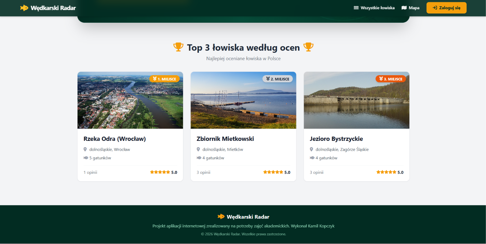
</p>

#### Efekt działania:
Po wybraniu lokalizacji, system na żywo przelicza wskaźnik brań (Bite Score), aktualizuje dane o ciśnieniu, fazie księżyca, pogodzie i rysuje dobowy wykres aktywności ryb.
<p align="center">
  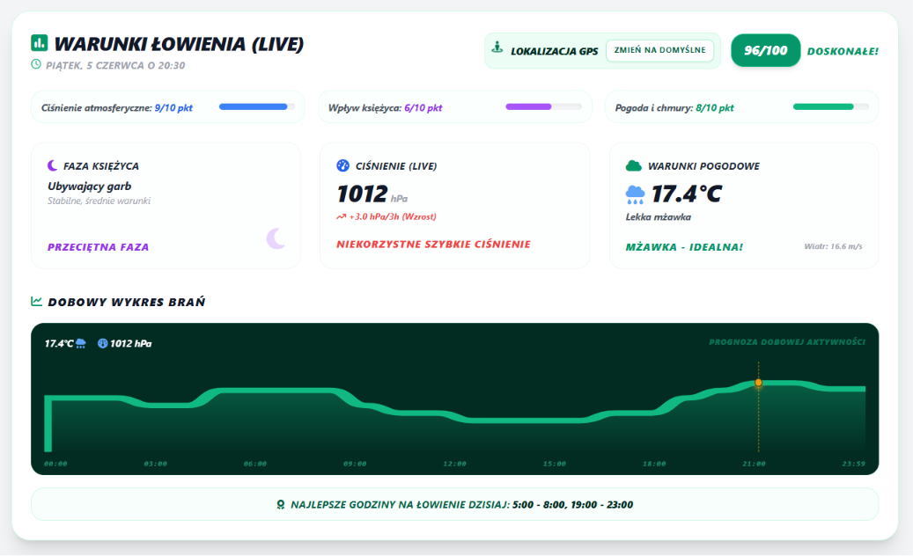
</p>

### 2. Interaktywna Mapa i Wyszukiwarka Lokalna (Geolokalizacja)
#### Co może zrobić użytkownik:
Użytkownik może szukać łowisk w określonym promieniu od podanej miejscowości za pomocą filtrów bocznych i suwaka.

#### Efekt działania:
Mapa zostaje wycentrowana na wybranym mieście, wyrysowuje się okrąg wyszukiwania, a na mapie pojawiają się pinezki łowisk, które spełniają kryteria.
<p align="center">
  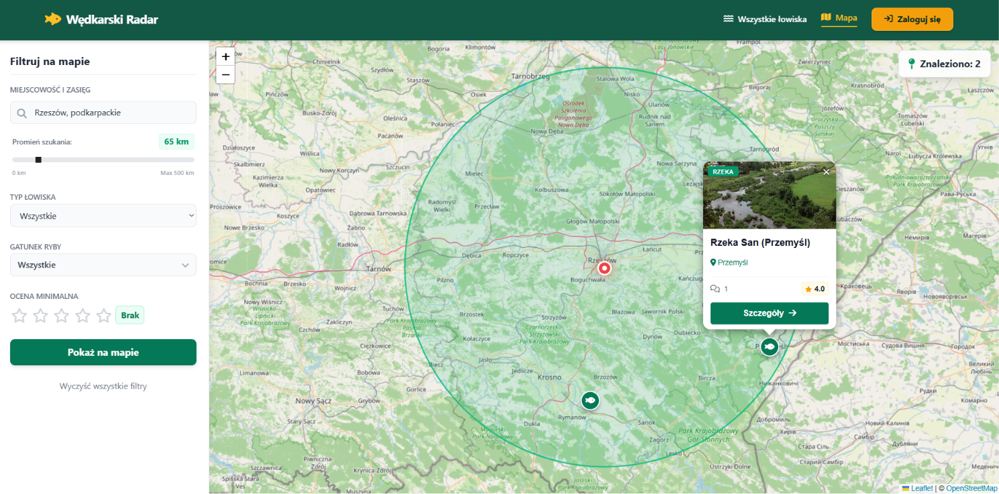
</p>

### 3. Karta Szczegółów Łowiska
#### Co może zrobić użytkownik:
Użytkownik przegląda szczegóły łowiska, zdjęcia z Wikipedii, opisy, udogodnienia oraz wykresy brań dla danego akwenu.
<p align="center">
  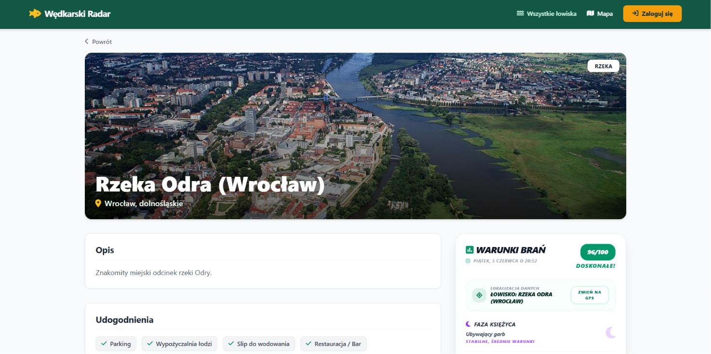
</p>
<p align="center">
  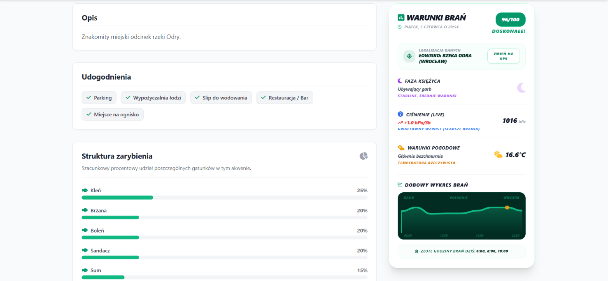
</p>

#### Efekt działania:
Użytkownik zyskuje pełny wgląd w dany akwen, w tym podgląd na listę najlepszych rekordów medalowych z tego jeziora.
<p align="center">
  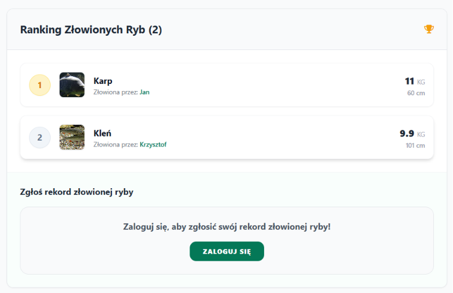
</p>

### 4. Dodawanie Opinii i Ocen Połówkowych
#### Co może zrobić użytkownik:
Zalogowany użytkownik może wypełnić formularz opinii, wpisując komentarz i wybierając ocenę (możliwe oceny połówkowe np. 4.5 gwiazdki).
<p align="center">
  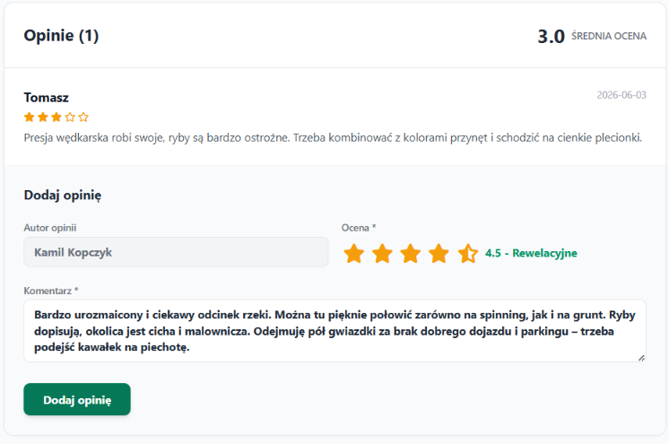
</p>

#### Efekt działania:
Opinia natychmiast zostaje dołączona do listy komentarzy, a średnia ocen łowiska zostaje przeliczona.
<p align="center">
  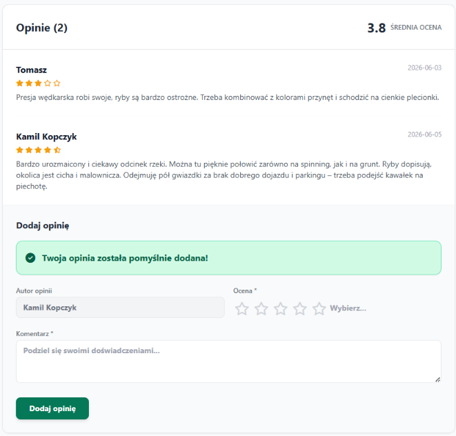
</p>

### 5. Zgłaszanie Rekordów Ryb
#### Co może zrobić użytkownik:
Zalogowany wędkarz może zgłosić złowioną rybę do rankingu medalowego, podając wagę, długość oraz załączając zdjęcie z dysku.
<p align="center">
  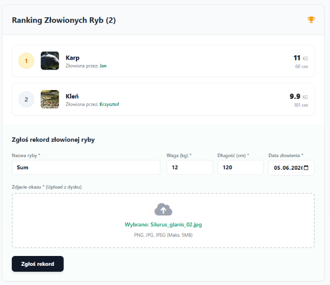
</p>

#### Efekt działania:
Zgłoszenie zostaje zapisane w bazie i oczekuje na weryfikację przez administratora. Użytkownik widzi status w swoim profilu.
<p align="center">
  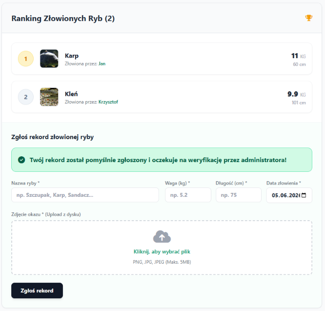
</p>

### 6. Profil Użytkownika (Mój Profil)
#### Co może zrobić użytkownik:
Wędkarz w swoim panelu przełącza się między zakładkami "Moje opinie", "Zgłoszone rekordy" i "Ulubione łowiska", przeglądając historię swojej aktywności.
<p align="center">
  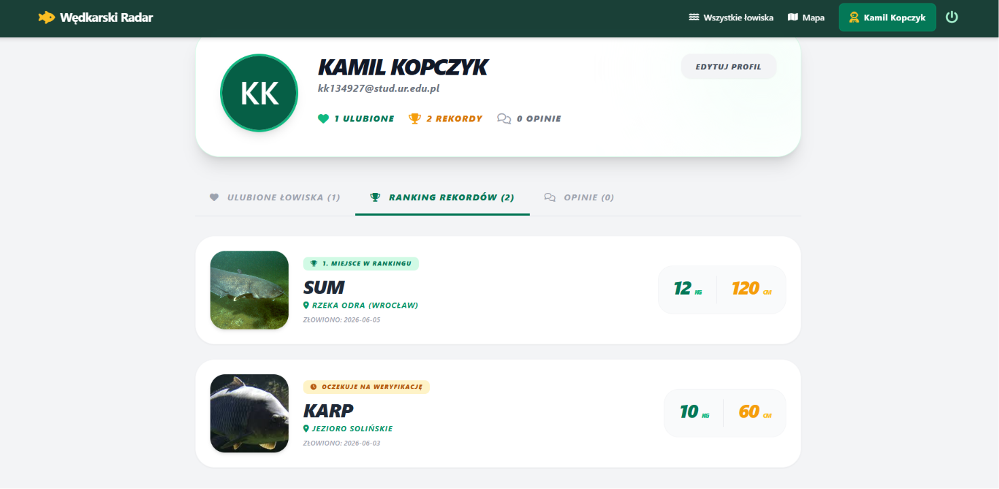
</p>

#### Efekt działania:
Kliknięcie czerwonego serduszka przy "Ulubionym łowisku" wywołuje asynchroniczne usunięcie go z listy. Karta łowiska płynnie znika bez przeładowywania strony, tak samo jest z dodawaniem ich do ulubionych.

---

## Podręcznik administratora

Panel Administracyjny (Admin Dashboard) jest całkowicie odseparowany i dostępny wyłącznie dla ról `admin`. 

### 1. Zarządzanie Łowiskami
#### Co może zrobić administrator:
Administrator przegląda listę łowisk. Może kliknąć "Dodaj Łowisko" i wypełnić formularz z walidacją po stronie serwera (np. sprawdzającą czy suma udziałów ryb nie przekracza 100%).
<p align="center">
  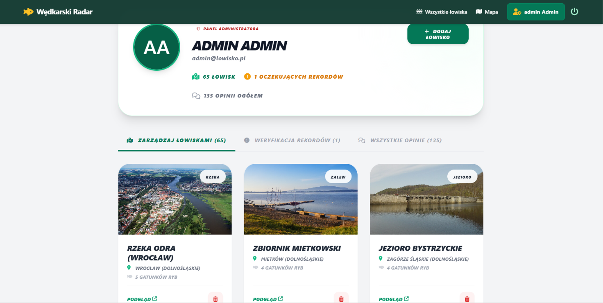
</p>
<p align="center">
  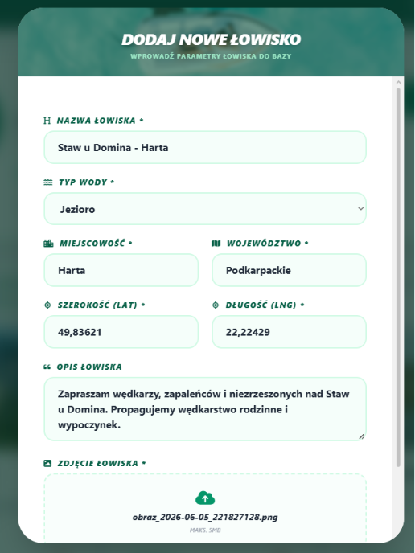
</p>

#### Efekt działania:
Łowisko zostaje dodane do systemu i jest od razu widoczne dla wszystkich użytkowników na mapie oraz na liście.
<p align="center">
  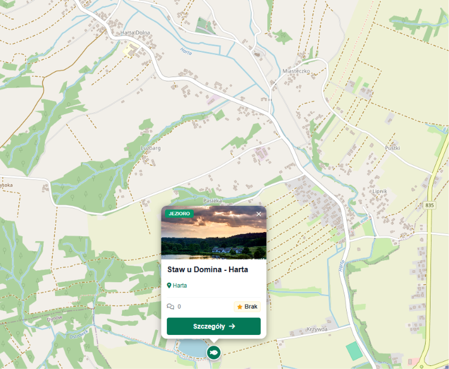
</p>

#### Edycja łowiska:
Administrator może edytować dane istniejącego łowiska, w tym zmienić nazwę, typ akwenu, współrzędne, opis, zdjęcie główne, udogodnienia oraz zarybienie (z zachowaniem walidacji sumy procentowej ≤ 100%). Zmiany są synchronizowane z relacjami w bazie danych za pomocą metody `sync()` Eloquent.
<p align="center">
  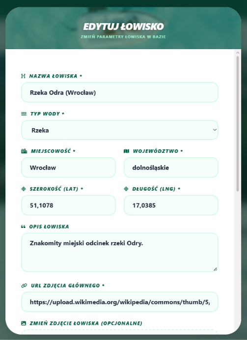
</p>

#### Efekt działania:
Po zapisaniu zmian, zaktualizowane dane łowiska są od razu widoczne na mapie, liście łowisk oraz karcie szczegółowej.
<p align="center">
  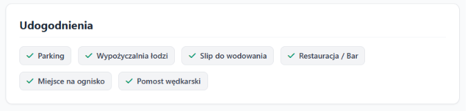
</p>

#### Usuwanie łowisk:
Administrator może bezpowrotnie usunąć wybrane łowisko ze struktury bazy danych. Aby zapobiec przypadkowemu skasowaniu (ponieważ usunięcie działa kaskadowo i kasuje również opinie oraz rekordy przypisane do łowiska), system wyświetla modal z prośbą o ostateczne potwierdzenie.

<p align="center">
  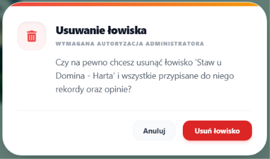
</p>


#### Efekt działania:
Po potwierdzeniu, łowisko zostaje skasowane i natychmiastowo znika z panelu, z mapy oraz z rankingów.

<p align="center">
  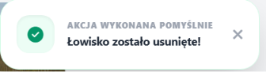
</p>

<p align="center">
  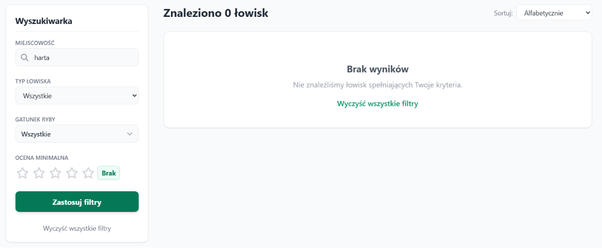
</p>

### 2. Weryfikacja Rekordów
#### Co może zrobić administrator:
W zakładce weryfikacji administrator przegląda oczekujące zgłoszenia ryb. Może podjąć decyzję o zatwierdzeniu lub odrzuceniu rekordu.
<p align="center">
  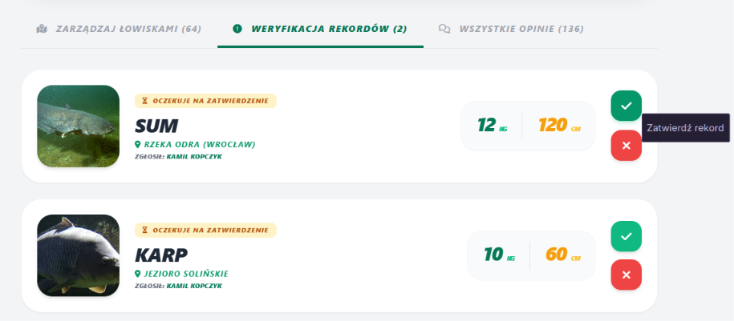
</p>
<p align="center">
  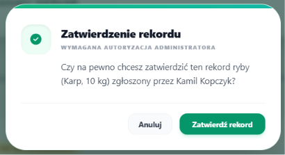
</p>
<p align="center">
  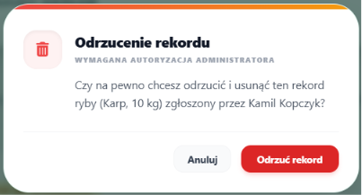
</p>

#### Efekt działania:
Zależnie od podjętej decyzji, rekord trafia do publicznego rankingu medalowego (jeśli zatwierdzony) lub zostaje oznaczony jako odrzucony.
<p align="center">
  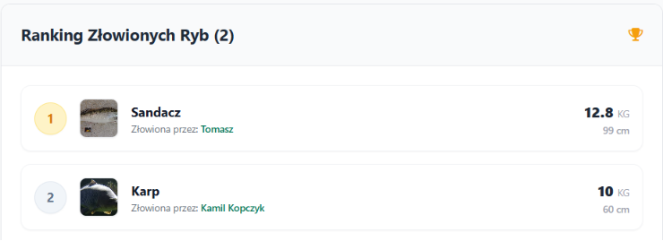
</p>
<p align="center">
  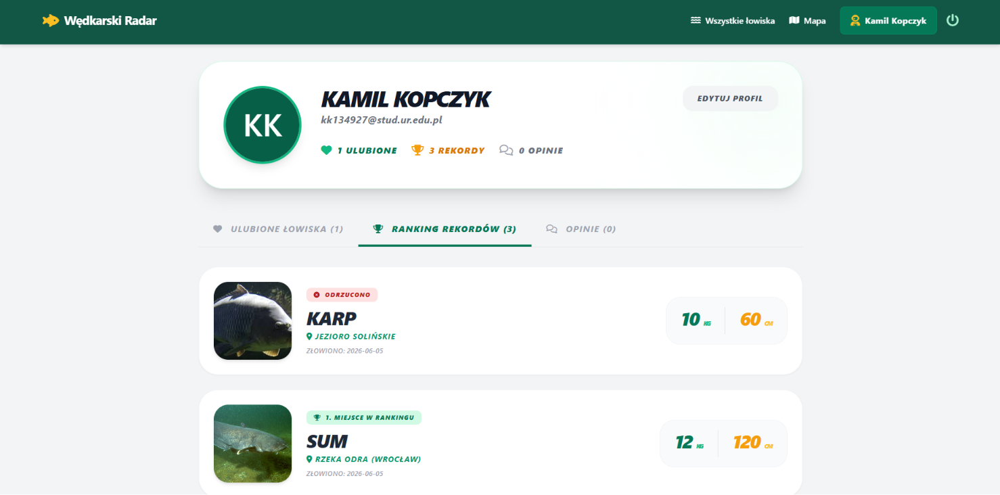
</p>

### 3. Moderacja Opinii
#### Co może zrobić administrator:
Administrator może przeglądać listę opinii użytkowników i usuwać niecenzuralne lub fałszywe komentarze.
<p align="center">
  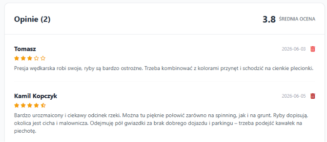
</p>

#### Efekt działania:
Po potwierdzeniu w modalu (zabezpieczenie przed usunięciem), opinia zostaje trwale skasowana z systemu i znika z karty łowiska.
<p align="center">
  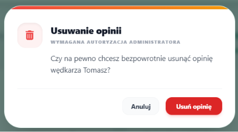
</p>

---

## RWD - Interfejs Mobilny
Zadbałem o to, aby cała aplikacja była w pełni responsywna na ekranach telefonów i tabletów. Zablokowałem w poziomie przewijanie ekranu oraz wymusiłem sztywną skalę (viewport), dzięki czemu strona zachowuje się jak natywna aplikacja.

#### Co widzi użytkownik na telefonie:
Na urządzeniach mobilnych pasek nawigacyjny staje się pływający i rozwijany do pełnego widoku.

<p align="center">
  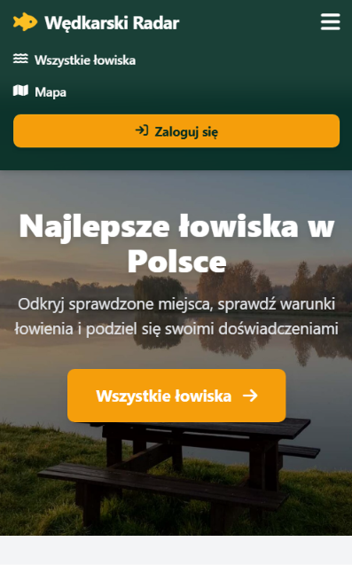
</p>

#### Efekt responsywności mapy:
Panel wyszukiwarki na telefonach odrywa się od krawędzi i staje się w połowie przezroczysty, dzięki czemu mapa znajduje się bezpośrednio "pod filtrami" zajmując cały ekran.

<p align="center">
  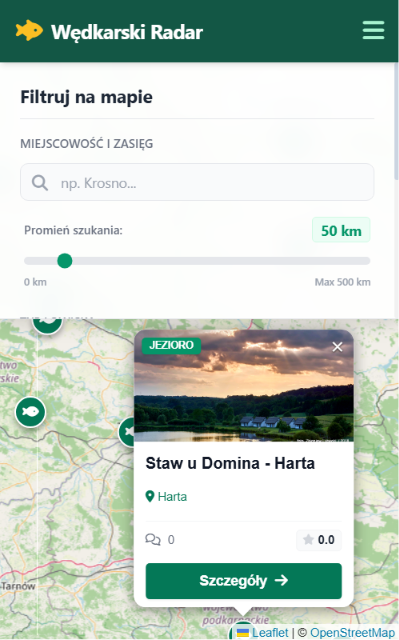
</p>

#### Efekt responsywności szczegółów:
Karta szczegółowa łowiska na urządzeniu mobilnym inteligentnie zawija paski i tabele ocen do widoku jednokolumnowego, chroniąc przed poziomym rozjeżdżaniem układu.

<p align="center">
  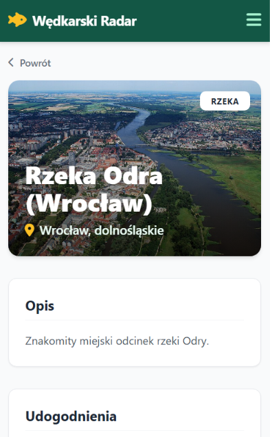
</p>

---

### Opis ról w systemie

| Rola | Dostęp publiczny (Gość) | Zalogowany Wędkarz | Administrator |
| :--- | :---: | :---: | :---: |
| Przeglądanie mapy i łowisk | TAK | TAK | TAK |
| Odczyt prognozy brań i wykresów | TAK | TAK | TAK |
| Dodawanie łowisk do ulubionych | NIE | TAK | TAK |
| Pisanie opinii i ocen | NIE | TAK | TAK |
| Zgłaszanie rekordów (ze zdjęciem) | NIE | TAK | TAK |
| Dodawanie łowisk do bazy | NIE | NIE | TAK |
| Edycja łowiska i rybostanu | NIE | NIE | TAK (Zabezpieczenie sumy ryb <= 100%) |
| Usuwanie łowisk / opinii | NIE | NIE | TAK |
| Weryfikacja rekordów | NIE | NIE | TAK |

---

### Przypadki brzegowe i walidacja danych

Zabezpieczyłem system przed nietypowymi błędami oraz próbami wprowadzenia błędnych danych:
*   **Suma udziałów procentowych ryb powyżej 100%:** Podczas edycji łowiska przez administratora, system weryfikuje sumę wprowadzonych procentów zarybienia. Jeśli suma przekracza 100%, formularz jest blokowany (walidacja serwerowa w `AdminController` oraz natychmiastowa walidacja w przeglądarce za pomocą kodu JavaScript). Dane nie zostają zapisane w bazie, a użytkownik otrzymuje czytelny komunikat o błędzie.
*   **Wprowadzenie tekstu w pola liczbowe (np. waga/długość ryby):** Formularz HTML blokuje wpisywanie znaków nie-numerycznych, a kontroler weryfikuje dane regułą `numeric|min:0.01` oraz `integer|min:1`.
*   **Zgłaszanie rekordu z datą z przyszłości:** Data złowienia ryby jest weryfikowana regułą `before_or_equal:today`. Użytkownik nie może wybrać w kalendarzu jutrzejszego ani kolejnych dni.
*   **Przesyłanie zbyt dużych plików graficznych lub plików o złym formacie:** Formularz akceptuje wyłącznie pliki o rozszerzeniach graficznych (`jpeg, png, jpg, gif`) do rozmiaru `5120 KB` (5 MB), co zabezpiecza przestrzeń dyskową serwera przed przeciążeniem.

---

### Kluczowe mechanizmy aplikacyjne

#### 1. Wskaźnik prognozy brań (Bite Forecast)
Zbudowałem algorytm łączący biologię ryb słodkowodnych z warunkami środowiskowymi. Wykorzystuje on następujące zmienne:
1.  **Faza Księżyca:** Obliczana lokalnym algorytmem astronomicznym na podstawie uproszczonego czasu juliańskiego. Zwraca fazy takie jak *Nów* (najlepsza aktywność ryb - 95 pkt), *Pełnia* (bardzo dobra aktywność nocna - 85 pkt) czy *Pierwsza Kwadra* (umiarkowane brania - 60 pkt).
2.  **Ciśnienie Atmosferyczne:** Odczytywane w czasie rzeczywistym z Open-Meteo API. System wylicza różnicę ciśnienia między stanem obecnym a stanem sprzed 3 godzin. Gwałtowne wahania obniżają wskaźnik brania, spadek lub ciśnienie stabilne podwyższają go.
3.  **Temperatura i Pogoda:** Lekkie deszcze napowietrzają wodę. Skrajne temperatury (ponad 30°C i poniżej 2°C) wprowadzają ryby w letarg, co obniża wskaźnik.

#### 2. Geolokalizacja sferyczna (filtr odległościowy Leaflet + Nominatim)
Filtrowanie odległościowe zrealizowałem po stronie klienta w JavaScript, wykorzystując wbudowaną metodę `L.latLng.distanceTo()` biblioteki Leaflet. Współrzędne wybranej miejscowości są pobierane w czasie rzeczywistym z API Nominatim (geokodowanie), po czym dla każdego łowiska obliczana jest odległość sferyczna od punktu centralnego. Na mapie wyświetlane są wyłącznie łowiska mieszczące się w zdefiniowanym promieniu (suwak 0–500 km), a wizualny okrąg (`L.circle`) rysowany jest na warstwie mapy jako graficzne potwierdzenie zasięgu.

#### 3. Integracja z API Wikipedii (MediaWiki API)
W celu zautomatyzowania procesu pozyskiwania zdjęć dla łowisk oraz gatunków ryb, napisałem seeder `UpdateUniqueImagesSeeder.php`, który integruje się z polskojęzyczną Wikipedią za pomocą jej otwartego interfejsu programistycznego **MediaWiki API**.
*   **Oczyszczanie i normalizacja fraz wyszukiwania:** Przed wysłaniem zapytania system filtruje nazwy za pomocą wyrażeń regularnych (np. usuwa dopiski w nawiasach okrągłych, takie jak `Jezioro Solińskie (Solina) -> Jezioro Solińskie`) oraz normalizuje nazwy rzek poprzez usuwanie zbędnych prefiksów.
*   **Dynamiczne zapytanie wyszukiwania:** Zapytanie HTTP wysyłane jest pod adres `pl.wikipedia.org/w/api.php` z parametrami `generator=search` i `gsrlimit=1`. Parametr `prop=pageimages` żąda dołączenia metadanych o głównej grafice artykułu z Wikimedia Commons, a `pithumbsize=800` wymusza wyrenderowanie miniatury o szerokości 800px.
*   **Bezpieczne dekodowanie odpowiedzi JSON:** Kod używa funkcji `reset()` w PHP w celu wydobycia pierwszego elementu asocjacyjnego z tablicy `pages` i pobrania bezpośredniego adresu URL miniatury (`thumbnail -> source`).
*   **Obsługa błędów i fallback:** Jeśli Wikipedia nie posiada artykułu z grafiką dla danej frazy, seeder automatycznie przypisuje estetyczne zdjęcie zapasowe (fallback) z serwisu LoremFlickr.

#### 4. Algorytm obliczania faz księżyca (Wbudowany silnik astronomiczny)
Do wyznaczenia wpływu Księżyca na żerowanie ryb (w ramach mechanizmu **Bite Forecast**) zaimplementowałem algorytm obliczeń astronomicznych bezpośrednio w JavaScript po stronie klienta (w plikach szablonów Blade: `dashboard.blade.php` oraz `szczegoly.blade.php`). Obliczenia wykonywane są lokalnie w czasie rzeczywistym, co gwarantuje brak opóźnień sieciowych.
*   **Konwersja daty kalendarzowej**: Algorytm pobiera aktualną datę z obiektu `Date` w JavaScript, wyodrębniając rok, miesiąc oraz dzień. W przypadku miesięcy zimowych (styczeń i luty) dokonuje korekty, traktując je jako 13. i 14. miesiąc roku poprzedniego.
*   **Obliczenie przybliżonego czasu juliańskiego (Julian Date)**:
    $$jd = (365.25 \times \text{rok}) + (30.6 \times \text{miesiąc}) + \text{dzień} - 694039.09$$
    Wartość `694039.09` to stała przesunięcia odpowiadająca bazowej dacie nowiu Księżyca.
*   **Obliczenie pozycji w cyklu synodycznym**:
    $$\text{pozycja\_cyklu} = \frac{jd}{29.5305882}$$
*   **Ekstrakcja części ułamkowej**: Poprzez odjęcie pełnej liczby przebytych cykli (za pomocą `parseInt`), uzyskujemy ułamek z zakresu $[0.0, 1.0)$, reprezentujący pozycję Księżyca w cyklu orbitalnym.
*   **Rzutowanie na 8 głównych faz księżyca**: Pozycja ułamkowa jest mnożona przez 8 i zaokrąglana do najbliższej liczby całkowitej (z korektą przepełnienia z 8 do 0). Wynikowy indeks ($0-7$) odpowiada kolejno następującym fazom:
    *   **0: Nów** (wskaźnik: **95/100**) – optymalne żerowanie, ryby drapieżne bardzo aktywne.
    *   **1: Młody księżyc** (wskaźnik: **75/100**) – wysoka aktywność.
    *   **2: Pierwsza kwadra** (wskaźnik: **60/100**) – umiarkowane żerowanie.
    *   **3: Przyrastający garb** (wskaźnik: **45/100**) – słabsze brania.
    *   **4: Pełnia** (wskaźnik: **85/100**) – bardzo silne brania, w szczególności w godzinach nocnych.
    *   **5: Ubywający garb** (wskaźnik: **55/100**) – stabilne warunki średnie.
    *   **6: Trzecia kwadra** (wskaźnik: **40/100**) – spadek żerowania za dnia.
    *   **7: Ubywający sierp** (wskaźnik: **70/100**) – stopniowy wzrost aktywności ryb.

---

## Architektura i struktura bazy danych

Baza danych aplikacji została zaprojektowana w modelu relacyjnym. W środowisku deweloperskim i testowym domyślnie wykorzystywana jest baza SQLite 3, co ułatwia przenoszenie i natychmiastowe uruchomienie projektu bez konieczności konfiguracji zewnętrznych serwerów bazodanowych.

### Schemat powiązań encji (ERD)

Poniższy diagram przedstawia tabele bazy danych oraz relacje zachodzące między nimi. Wygenerowany diagram dostępny jest również jako grafika poniżej:

<p align="center">
  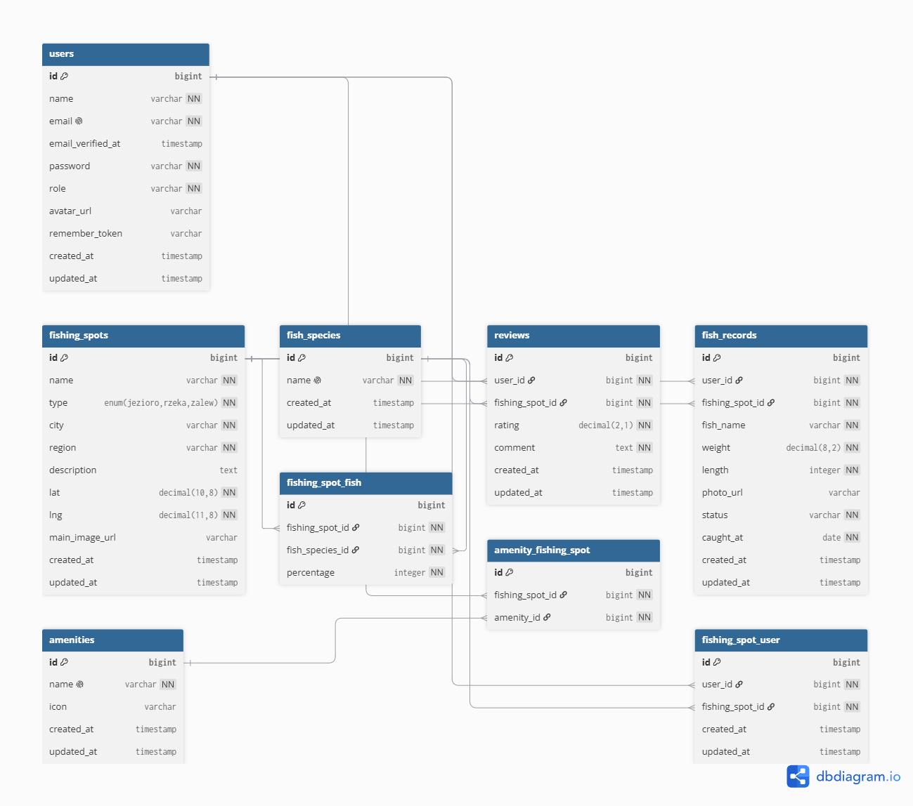
</p>

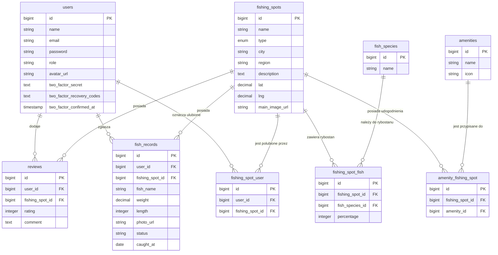

### Opis tabel bazy danych

#### 1. Tabela `users` (Użytkownicy)
Przechowuje dane dotyczące kont zarejestrowanych wędkarzy oraz administratorów.
*   `id` (BigInt, PK) – unikalny identyfikator użytkownika.
*   `name` (String) – pseudonim wędkarza.
*   `email` (String, Unique) – adres e-mail (login).
*   `password` (String) – zahaszowane hasło użytkownika.
*   `role` (String) – rola w systemie (`user` dla wędkarza, `admin` dla administratora).
*   `avatar_url` (String, Nullable) – ścieżka do awatara profilowego.

#### 2. Tabela `fishing_spots` (Łowiska)
Zawiera szczegółowe informacje o akwenach wodnych.
*   `id` (BigInt, PK) – unikalny identyfikator łowiska.
*   `name` (String) – nazwa łowiska.
*   `type` (Enum) – typ zbiornika wodnego (`jezioro`, `rzeka`, `zalew`).
*   `city` (String) – najbliższa miejscowość.
*   `region` (String) – województwo.
*   `description` (Text, Nullable) – opis łowiska.
*   `lat` (Decimal 10,8), `lng` (Decimal 11,8) – współrzędne geograficzne.
*   `main_image_url` (String, Nullable) – adres URL grafiki głównej.

#### 3. Tabela `fish_species` (Gatunki ryb)
Słownik gatunków ryb, które mogą występować w akwenach.
*   `id` (BigInt, PK) – unikalny identyfikator gatunku.
*   `name` (String, Unique) – nazwa gatunku ryby.

#### 4. Tabela `reviews` (Opinie o łowiskach)
Komentarze i oceny wystawiane przez wędkarzy.
*   `id` (BigInt, PK) – unikalny identyfikator opinii.
*   `user_id` (BigInt, FK) – powiązanie z użytkownikiem (`cascadeOnDelete`).
*   `fishing_spot_id` (BigInt, FK) – powiązanie z łowiskiem (`cascadeOnDelete`).
*   `rating` (Decimal 2,1) – ocena w skali 0.5–5.0 (obsługa ocen połówkowych, np. 4.5).
*   `comment` (Text) – treść opinii.

#### 5. Tabela `fish_records` (Medalowe rekordy ryb)
Zgłoszenia medalowych okazów złowionych przez użytkowników.
*   `id` (BigInt, PK) – unikalny identyfikator rekordu.
*   `user_id` (BigInt, FK) – powiązanie z wędkarzem (`cascadeOnDelete`).
*   `fishing_spot_id` (BigInt, FK) – powiązanie z łowiskiem (`cascadeOnDelete`).
*   `fish_name` (String) – nazwa ryby.
*   `weight` (Decimal 8,2) – waga ryby w kg.
*   `length` (Integer) – długość ryby w cm.
*   `photo_url` (String, Nullable) – ścieżka do zdjęcia okazu.
*   `status` (String) – status weryfikacji (`pending`, `approved`, `rejected`).
*   `caught_at` (Date) – data złowienia.

#### 6. Tabela `amenities` (Udogodnienia)
Słownik udogodnień dostępnych wokół łowiska.
*   `id` (BigInt, PK) – unikalny identyfikator udogodnienia.
*   `name` (String, Unique) – nazwa udogodnienia (np. Parking, Toaleta).
*   `icon` (String, Nullable) – klasa ikony FontAwesome do wyrenderowania.

---

## Mechanizmy bezpieczeństwa i jakości kodu

### 1. System autoryzacji (Gate + Policy)
System bezpieczeństwa oparty jest na mechanizmie bramek autoryzacji Laravel (`Gate`) i polityk (`Policy`).
*   **Bramka `is-admin`:** Zdefiniowana w `AppServiceProvider`, weryfikuje, czy zalogowany użytkownik posiada rolę `admin` w kolumnie `role` tabeli `users`.
*   **Reguła nadrzędna (`Gate::before`):** Administrator automatycznie przechodzi pomyślnie wszystkie testy uprawnień w systemie, co eliminuje konieczność dodawania osobnych reguł dla każdej akcji.
*   **`ReviewPolicy`:** Polityka definiująca, że tylko autor opinii może ją edytować lub usunąć (porównanie `user_id` z identyfikatorem zalogowanego wędkarza).

### 2. Middleware rejestracji aktywności (LogActivity)
W warstwie pośredniczącej HTTP zaimplementowałem własny middleware `LogActivity`, który przechwytuje każde przychodzące żądanie HTTP i rejestruje:
*   Metodę żądania (GET/POST/PUT/DELETE) oraz URI docelowy.
*   Adres e-mail zalogowanego użytkownika lub status `anonymous` dla gości.
Logi zapisywane są na dwóch kanałach: `stderr` (standardowe wyjście błędów) oraz `single` (plik `laravel.log`), co ułatwia monitoring i audyt bezpieczeństwa.

---

## Testy automatyczne (Pest PHP)

Projekt wykorzystuje framework testowy **Pest PHP** (w wersji 4.x) zintegrowany z Laravel. Testy znajdują się w katalogu `tests/Feature/` i pokrywają kluczowe funkcjonalności aplikacji.

### Pokrycie testami:

| Plik testowy | Opis | Liczba testów |
| :--- | :--- | :---: |
| `AdminSpotTest.php` | Tworzenie, edycja łowisk; walidacja sumy zarybienia ≤ 100%; walidacja procentów = 0% | 6 |
| `ReviewTest.php` | Dodawanie opinii przez zalogowanego wędkarza (walidacja ratingu i komentarza) | 1 |
| `Auth/AuthenticationTest.php` | Logowanie, renderowanie strony logowania, ochrona przed błędnymi danymi | 3 |
| `Auth/RegistrationTest.php` | Rejestracja nowego użytkownika | 2 |
| `Auth/TwoFactorChallengeTest.php` | Weryfikacja 2FA, przekierowania przy braku sesji | 2 |
| `Auth/EmailVerificationTest.php` | Weryfikacja e-mail, ochrona widoków | 3 |
| `Settings/ProfileUpdateTest.php` | Aktualizacja profilu, zmiana hasła | 3 |
| `Settings/SecurityTest.php` | Ustawienia bezpieczeństwa konta | 3 |

Uruchomienie testów:
```bash
php artisan test
```

### Ciągła integracja (GitHub Actions)
Projekt posiada konfigurację CI/CD w katalogu `.github/workflows/`:
*   **`tests.yml`** – automatyczne uruchamianie pełnego zestawu testów przy każdym pushu i pull requeście.
*   **`lint.yml`** – analiza statyczna i formatowanie kodu za pomocą Laravel Pint.

---

## Plany rozbudowy

- **Czego zabrakło w pierwszej wersji projektu?**
  W wersji v1.0 zabrakło interaktywnych map batymetrycznych (pokazujących ukształtowanie i głębokość dna jezior) oraz bezpośredniej integracji z płatnościami za zezwolenia wędkarskie.
- **Jakie funkcjonalności mogłyby powstać w "v2.0"?**
  - **Integracja z płatnościami (Stripe/BLIK):** System e-zezwoleń umożliwiający natychmiastowe opłacenie dobowej składki wędkarskiej na łowiskach prywatnych i państwowych (generowanie PDF z kodem QR do kontroli).
  - **Automatyczne powiadomienia e-mail / Web Push:** Powiadomienia wysyłane do wędkarzy, gdy prognozowany wskaźnik brań na ich ulubionym łowisku przekroczy `85/100`.
  - **Baza danych cenników i regulaminów dzierżawców:** Podpięcie bezpośrednich odnośników do stron internetowych kół PZW oraz cenników zezwoleń.
- **Gdzie dostrzegam potencjał na optymalizację?**
  - **Keszowanie (Redis / Memcached):** Zapisywanie prognoz pogodowych i koordynatów miast w pamięci podręcznej na okres 1 godziny w celu redukcji liczby zapytań do API Open-Meteo i Nominatim.
  - **Przeniesienie na MySQL/PostgreSQL:** W środowisku produkcyjnym SQLite powinno zostać zastąpione bazą PostgreSQL w celu lepszej obsługi współbieżnych zapytań i indeksowania współrzędnych przestrzennych (PostGIS).

---

## Proponowana ocena

**Proponowana ocena z projektu: 3.0**
